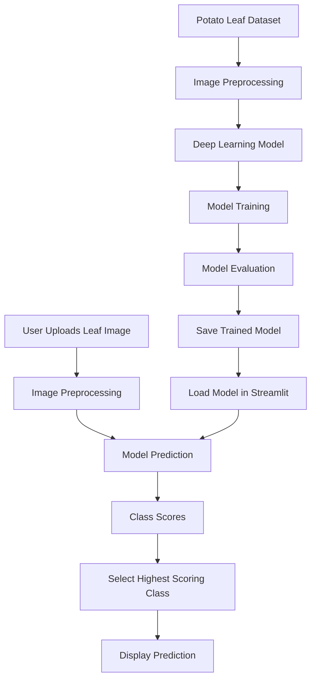
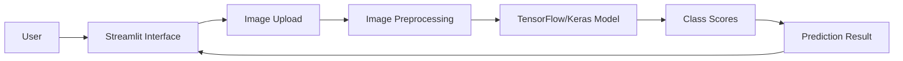

# 🌿 PotatoCare – Potato Leaf Disease Classification

An AI-powered web application that uses deep learning to identify potato leaf diseases from uploaded images.

PotatoCare uses a TensorFlow/Keras image classification model to classify potato leaves into three categories: **Early Blight, Late Blight, and Healthy**. The application provides an interactive interface built with Streamlit, allowing users to upload leaf images and view the model's predictions.

---

## 📌 Table of Contents

- [Project Overview](#-project-overview)
- [Problem Statement](#-problem-statement)
- [Objectives](#-objectives)
- [Features](#-features)
- [Workflow](#-workflow)
- [System Architecture](#-system-architecture)
- [Technologies Used](#-technologies-used)
- [Dataset](#-dataset)
- [Model Information](#-model-information)
- [Project Structure](#-project-structure)
- [Installation and Setup](#-installation-and-setup)
- [Application Usage](#-application-usage)
- [Future Improvements](#-future-improvements)
- [Limitations](#-limitations)
- [Author](#-author)

---

## 🌱 Project Overview

Potato diseases can affect crop health and agricultural productivity. Identifying diseases early can help farmers take appropriate action.

PotatoCare applies deep learning and computer vision techniques to classify potato leaf images automatically.

The project consists of two main components:

1. **Deep Learning Model:** A trained TensorFlow/Keras model that performs image classification.
2. **Web Application:** A Streamlit interface that allows users to upload images and view predictions.

## 🎯 Problem Statement

Manual identification of potato leaf diseases can be difficult and time-consuming. An automated image classification system can assist in identifying visible disease patterns from leaf images.

This project aims to develop a deep learning-based system that classifies potato leaf images into predefined disease categories.

## 🎯 Objectives

- Develop an image classification model using TensorFlow/Keras.
- Identify three categories of potato leaf conditions.
- Process uploaded images for model inference.
- Build an interactive web application using Streamlit.
- Present prediction results through a simple and user-friendly interface.

## ✨ Features

- **Image Upload:** Upload potato leaf images in JPG, JPEG, and PNG formats.
- **Image Preview:** Preview the selected image before analysis.
- **AI-Based Classification:** Use a trained deep learning model to classify the image.
- **Three-Class Prediction:** Identify Early Blight, Late Blight, or Healthy Leaf.
- **Model Score:** Display the highest predicted class score.
- **Interactive Interface:** Clean and responsive Streamlit application.
- **GPU Support:** TensorFlow can use compatible GPU acceleration when available.

---

## ⚙️ Workflow

PotatoCare follows two major pipelines: model development and image prediction.

### 1. Model Development Workflow

1. **Dataset Collection:** Collect potato leaf images belonging to Early Blight, Late Blight, and Healthy categories.
2. **Image Preprocessing:** Prepare images in the required dimensions and format.
3. **Model Training:** Train a deep learning model using TensorFlow/Keras.
4. **Model Evaluation:** Evaluate model performance using suitable evaluation metrics.
5. **Model Saving:** Save the trained model in H5 format for future inference.

### 2. Prediction Workflow

1. **Image Upload:** The user uploads a potato leaf image through the Streamlit interface.
2. **Image Preprocessing:** Convert the image to RGB and resize it to 256 × 256 pixels.
3. **Model Inference:** Pass the processed image to the trained model.
4. **Class Prediction:** Obtain the output scores for all three classes.
5. **Result Selection:** Select the class with the highest output score.
6. **Result Display:** Display the predicted category and corresponding model score.

### Workflow Diagram



---

## 🏗️ System Architecture

The application follows a simple model-serving architecture.



### Architecture Components

| Component | Responsibility |
|---|---|
| User Interface | Accepts image uploads and displays results |
| Image Processing | Converts and resizes uploaded images |
| Deep Learning Model | Performs image classification |
| Prediction Logic | Selects the highest-scoring class |
| Result Display | Presents the predicted category and model score |

---

## 🛠️ Technologies Used

| Technology | Purpose |
|---|---|
| Python | Core programming language |
| TensorFlow | Deep learning framework |
| Keras | Model building and inference |
| NumPy | Numerical operations |
| Pillow (PIL) | Image loading and processing |
| Streamlit | Web application development |
| Jupyter Notebook | Model development and experimentation |
| Git and GitHub | Version control and project hosting |

---

## 📂 Dataset

The project uses potato leaf images organized into three categories:

| Category | Description |
|---|---|
| Potato___Early_blight | Potato leaves affected by Early Blight |
| Potato___Late_blight | Potato leaves affected by Late Blight |
| Potato___healthy | Healthy potato leaves |

The images are organized into class-specific directories for model development.

**Note:** Add the original dataset source, total image count, and train/validation/test split details here once verified.

---

## 🧠 Model Information

The trained model is used to classify potato leaf images into three output classes.

| Parameter | Value |
|---|---|
| Framework | TensorFlow / Keras |
| Model file | `potato_model_v1.h5` |
| Model format | H5 |
| Input shape | 256 × 256 × 3 |
| Number of output classes | 3 |
| Task | Multi-class image classification |

### Prediction Classes

1. Early Blight
2. Late Blight
3. Healthy Leaf

### Prediction Logic

The model returns a score for each output class. The application selects the class with the highest score using:

```python
predicted_index = np.argmax(prediction[0])
confidence = float(np.max(prediction[0])) * 100
```

The displayed score represents the model's highest output score. It should not be interpreted as a guaranteed probability of correct diagnosis.

**Important:** Image preprocessing during inference must match the preprocessing used during model training.

---

## 📁 Project Structure

```text
potato-disease/
│
├── potato_model_v1.h5
│
├── streamlit_app.py
│
├── app.py
│
├── notebooks/
│   └── potato.ipynb
│
├── potato_images/
│   ├── Potato___Early_blight/
│   ├── Potato___Late_blight/
│   └── Potato___healthy/
│
├── templates/
│   └── index.html
│
├── models/
│
├── outputs/
│
├── src/
│
├── README.md
└── .gitignore
```

---

## 🚀 Installation and Setup

Follow these steps to run PotatoCare locally.

### Prerequisites

- Python 3.13.11 (the version used during development)
- pip
- Git
- Sufficient memory and storage for TensorFlow and the trained model

### Step 1: Clone the Repository

```bash
git clone https://github.com/manojkumar2107/potato_disease_classification.git
```

### Step 2: Navigate to the Project Directory

```bash
cd potato_disease_classification
```

### Step 3: Install Dependencies

```bash
python -m pip install tensorflow streamlit numpy pillow
```

### Step 4: Run the Streamlit Application

```bash
python -m streamlit run streamlit_app.py
```

### Step 5: Open the Application

Open the local URL displayed in your terminal:

```text
http://localhost:8501
```

---

## 💻 Application Usage

1. Launch the Streamlit application.
2. Open the PotatoCare web interface.
3. Select a potato leaf image using the upload option.
4. Preview the uploaded image.
5. Click **Analyse Leaf Image**.
6. Wait for the model to process the image.
7. View the predicted disease category and model score.

---

## 🔮 Future Improvements

- Add a detailed model evaluation report.
- Display confusion matrix, precision, recall, and F1-score.
- Improve image preprocessing and prediction reliability.
- Add more potato disease categories.
- Provide educational information about each disease.
- Add image history and prediction tracking.
- Deploy the application on a cloud platform.
- Optimize inference speed and model size.

---

## ⚠️ Limitations

- The model is limited to the three categories included in its training dataset.
- Predictions may be affected by image quality, lighting, and background conditions.
- The model may not reliably classify images that differ significantly from its training data.
- The displayed model score is not a guarantee of prediction accuracy.
- The application is intended for educational and experimental use, not as a replacement for professional agricultural diagnosis.

---

## 👨‍💻 Author

**Manoj Kumar R**

B.Tech – Artificial Intelligence and Machine Learning  
Bannari Amman Institute of Technology

**GitHub:** [manojkumar2107](https://github.com/manojkumar2107)

---

## ⭐ Acknowledgement

This project was developed as a practical application of deep learning, computer vision, and web application development using Python.

If you find this project useful, consider giving the repository a star!
